# Shardbreaker Tactics: characters

The cast, by when they can join. First names only for now. Kits are first drafts to react to.

- **Starting roster:** base classes you pick your opening squad from. Whoever you don't pick can still turn up later in the run.
- **After Act 1:** characters who join already in an advanced class.
- **Event only:** joins through one specific event.
- **Found during the run:** recruited from recruit stops, the caged-traveller event and the tavern, plus any starting-roster characters you didn't pick.

## How they join a run

- **The Crossroads:** 5 starting-roster characters picked at random each run (6 with the draft unlock); there's no guaranteed Mender. Take 3.
- **Recruit stops, the caged traveller and the tavern:** offer cast characters who haven't joined yet, all equally likely. Anyone offered earlier in the act is held back until there aren't enough new faces to fill the offer.
- **Lysander:** joins only through his event, The Wandering Minstrel.
- **Act 2:** as it begins, a second Crossroads: two of the advanced characters wait by the fire and you take one. From then on they're in the recruit and tavern pools too.
- **Once a run:** each character joins at most once a run.
- **Weapons:** each character only ever wields the weapon type they start with (Menders: charms and arts), including after they ascend. They keep their weapon when they ascend, with two exceptions: Holt's crossbow becomes a longbow when he ascends to Sniper, and Crusaders are given a holy sword alongside their staff or charm.
- **Sprites:** every character and ascension is drawn by the unit rig; see the Named cast section of `VISUALS.md`. Their looks are set in `js/14b-cast.js`.

## How kits work

- **Signature kit:** each character has 1 passive and 3 abilities that belong to them alone.
- **Free slots:** 1–2 slots per character for customising, filled from scrolls or skills found during the run (the Shardbreaker scroll skills are the starting pool).
- **Costs:** spells cost **MP**, physical skills have a **cooldown (CD)** in turns. MP starts full and refills slowly (starting numbers: casters 20–30 MP, everyone else 0–10, +2 MP a turn).
- **Damage:** a multiple of the unit's normal attack power (Str or Mag + weapon Mt, with height, effectiveness and relics), e.g. "1.5×". Defence or Resistance is subtracted afterwards. Abilities aren't countered. Heals are a multiple of (Mag + 5).
- **In the game so far:** the 9 starting-roster characters and Lysander have their kits (the Abilities button in the command menu). Their passive replaces the random personal skill. The others still have a random personal skill for now.

### Shapes

| Shape | Meaning |
|---|---|
| Single | One target in range |
| Line N | N tiles in a straight line from the user |
| Pierce 2 | The adjacent tile and the one behind it |
| Cross | A plus shape: the target tile and the 4 next to it |
| Area r1 / r2 | Every tile within 1 or 2 of the target tile |
| Cone 3 | Widening in front of the user, 3 tiles deep |
| Arc | The 3 tiles in front of the user |
| Burst | Area around the user |
| Tile | Places or changes something on a tile |

### Status effects (kept light)

| Status | Effect |
|---|---|
| Poison | 2 damage a turn for 3 turns |
| Burn | 2 damage a turn for 2 turns; ends on water |
| Slow | −2 Move |
| Root | Can't move (can still act) |
| Stun | Skips their next turn |
| Blind | −20 Hit |
| Weak | Deals 30% less damage |
| Guard (buff) | Takes 30% less damage |

Creatures can be immune to some of these, shown on their info panel.

## Starting roster

Each base class ascends into one or two advanced classes at Lv 5.

| Name | Class | Ascends into | Gender |
|---|---|---|---|
| Kili | Archer | Sniper or Bow Cavalry | M |
| Vaar | Brawler | Berserker | M |
| Morrigan | Cultist | Witch or Shaman | F |
| Corvin | Elemental Mage | Archmage or Stormlord | F |
| Aldric | Knight | Juggernaut or Paladin | M |
| Maelis | Mender | Saint or Crusader | F |
| Rook | Rogue | Duelist or Assassin | M |
| Brynhildr | Shieldmaiden | Valkyrie or Aegis | F |
| Brin | Adventurer | Hero | M |
| Trent | Cavalier | Paladin or Warlord | M |

### Kili: Archer
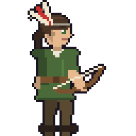

A poacher's son who has never missed a meal or a deer. Cheeky, and the one who climbs everything.
- **Ascends into:** Sniper or Bow Cavalry.
- **Look:** green leathers, feather headdress, longbow.
- **Passive: Eagle Eye.** +1 range on every shot, on top of the height bonus.
- **Aimed Shot** (single, range 2–5 · CD 2): 1.5× Str, as accurate as a normal attack.
- **Pinning Arrow** (single · CD 3): 0.8× Str and Root.
- **Volley** (area r1 at range 3–5 · CD 4): 0.7× Str to everything in the area.

### Vaar: Brawler
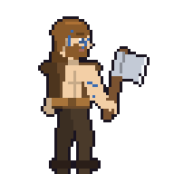

A village blacksmith from the northern fjords who fights barehanded because he won't take a weapon to war. Gentle giant.
- **Ascends into:** Berserker.
- **Look:** Nordic axeman, blue tattoos, earthy browns; a big two-headed axe over his shoulder as a Berserker.
- **Passive: Iron Body.** Can't be pushed or pulled.
- **Palm Strike** (single, adjacent · CD 1): 1.0× Str, push 2. Hitting a wall or unit deals extra damage, and falling off a ledge deals damage per level fallen.
- **Flurry** (single, adjacent · CD 3): 3 hits of 0.5× Str.
- **Leap** (tile, range 3, ignores height · CD 4): lands with 1.2× Str in area r1.

### Morrigan: Cultist
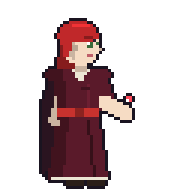

A witch-hunter's daughter who took up the dark arts to hunt the blight instead. Cold, and fiercely loyal once won over.
- **Ascends into:** Witch or Shaman.
- **Look:** scarlet hair, crimson cultist robes, casts from her hand.
- **Passive: Siphon.** Her dark spells heal her for 25% of the damage they deal.
- **Drain Touch** (single, adjacent · 4 MP): 1.2× Mag.
- **Hex** (single, range 3 · 5 MP): Weak for 2 turns.
- **Dark Pulse** (burst r1 · 10 MP): 1.0× Mag to every adjacent enemy.

### Corvin: Elemental Mage
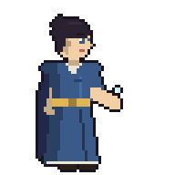

A court magician's apprentice who walked out when her master started making weapons for the war. Curious and methodical. Works in fire, frost and lightning.
- **Ascends into:** Archmage or Stormlord.
- **Look:** dress and formal cloak, casts from her hand; lightning down the robe as a Stormlord.
- **Passive: Attunement.** A spell of a different element from her last one costs 2 less MP.
- **Flame Burst** (cross at range 3 · 5 MP): 0.9× Mag, 30% chance to Burn.
- **Frost Wave** (cone 3 · 7 MP): 0.9× Mag and Slow.
- **Chain Lightning** (single, range 4 · 9 MP): 1.0× Mag, then jumps to up to 2 nearby enemies at 0.6×.

### Aldric: Knight
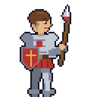

A landless knight whose lord sold his oath to the war. Earnest, and still believes in chivalry.
- **Ascends into:** Juggernaut or Paladin.
- **Look:** heavy armour in red and gold, lance and kite shield; a tower shield as a Juggernaut.
- **Passive: Plate.** Physical hits deal 2 less damage to him; −1 Jump.
- **Sunder** (single, adjacent · CD 2): 1.2× Str, and the target has −3 Def for 2 turns.
- **Valiant Thrust** (pierce 2 · CD 3): 1.0× Str to both tiles.
- **Cover** (single ally, adjacent · CD 3): until his next turn, attacks on that ally hit him instead.

### Maelis: Mender
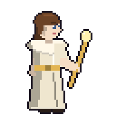

A hospice nun who has sat with too many dying soldiers. Calm, with gallows humour.
- **Ascends into:** Saint or Crusader.
- **Look:** white gown and shawl, gold staff.
- **Passive: Last Light.** Her heals restore 50% more on allies below half HP.
- **Mend** (single ally, range 3 · 4 MP): heals 1.2× Mag.
- **Purify** (single ally, range 3 · 3 MP): cures every bad status, Poison and Stone included.
- **Circle of Rest** (cross · 8 MP): heals 0.8× Mag and cures statuses.
- **Sanctuary** (area r1 · 10 MP): Guard on all allies in the area.

### Rook: Rogue
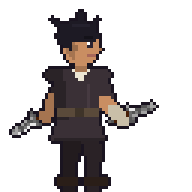

A street thief working off a debt to Ithren. Quick-mouthed and not as selfish as he pretends.
- **Ascends into:** Duelist or Assassin.
- **Look:** dark leathers, wrapped hands, jagged twin daggers.
- **Passive: Slippery.** Can move through enemy tiles, and can't be Rooted.
- **Backstab** (single, adjacent · CD 2): 1.0× Str, doubled from higher ground or when another ally is next to the target (flanking).
- **Smoke Bomb** (burst r1 · CD 4): Blinds enemies in the area; allies in it get +30 Avoid for 1 turn.
- **Tumble** (self · CD 2): move up to 2 more tiles, ignoring height; doesn't use his action.

### Brynhildr: Shieldmaiden
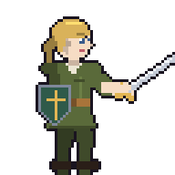

A city guardswoman who deserted rather than march on the neighbouring kingdom. Steady, dry and protective.
- **Ascends into:** Valkyrie or Aegis.
- **Look:** olive outfit, sword and decorated shield; a great bronze shield as Aegis, a pegasus as Valkyrie.
- **As Aegis:** immune to Stone (Stone Gaze).
- **Passive: Bulwark.** Allies next to her take 30% less damage from ranged attacks.
- **Shield Bash** (single, adjacent · CD 2): 1.0× Str, push 1.
- **Challenge** (burst r2 · CD 3): enemies in range must target her next turn.
- **Hold the Line** (self · CD 4): Guard, and she can't be pushed until her next turn.

### Brin: Adventurer
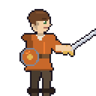

A farm boy who left home with a borrowed sword the day the beasts came. Eager, lucky, and better at this than anyone expected.
- **Ascends into:** Hero.
- **Look:** light armour in orange, sword and round shield.
- **Passive: Beginner’s Luck.** +10 Crit and +10 Avoid while at full HP.
- **Rally** (burst r1 · CD 3): adjacent allies get +2 Str and +2 Def for 2 turns.
- **Clean Cut** (single, adjacent · CD 2): 1.2× Str, as accurate as a normal attack.
- **Shield Up** (self · CD 3): Guard, and his counters deal 1.3× until your next turn.

## Joins after Act 1

As Act 2 begins, two of these offer to join; the rest turn up in the recruit and tavern pools. All of them come already advanced, apart from Valen, who joins as a Swordsman and can still ascend to Swordmaster.

| Name | Class | Gender |
|---|---|---|
| Nyx | Assassin | F |
| Roark | Berserker | M |
| Valen | Swordsman (ascends into Swordmaster) | M |
| Celestine | Paladin | F |
| Zwei | Mercenary | F |
| Kyul | Warlock | M |

### Nyx: Assassin
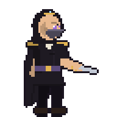

Nyx isn't her real name. No past, and a contract on Ithren that she has chosen not to fulfil. Yet.
- **Look:** all in black, hood and face covering, jagged dagger.
- **Passive: Unseen.** Enemies won't target her if another unit is in reach.
- **Mark for Death** (single, range 4 · CD 4): the target takes 30% more damage from everyone for 2 turns.
- **Shadowstep** (tile behind an enemy within 4 · CD 3): teleports there.
- **Execute** (single, adjacent · CD 4): 1.0× Str, or 3.0× if the target is below 30% HP.

### Roark: Berserker
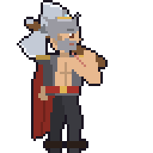

A grey-haired mercenary who drinks too much and fights better for it. Loud, and the tavern regulars love him.
- **Look:** grey hair and beard, scarred shoulder, red and grey, a big two-headed axe over his shoulder.
- **Passive: Fury.** +15 Crit while below half HP.
- **Cleave** (arc · CD 2): 1.0× Str.
- **Whirlwind** (burst r1 · CD 4): 1.1× Str to everyone adjacent.
- **Reckless Blow** (single, adjacent · CD 3): 1.8× Str, but he takes 25% more damage until his next turn.

### Valen: Swordsman
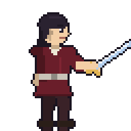

A noble fencing master whose student died to a crystallised beast. Proud and precise.
- **Ascends into:** Swordmaster.
- **Look:** long blonde hair, burgundy, tall boots, a fencer’s guard; wristguards and lapels as a Swordmaster.
- **Passive: Riposte.** His counters deal 1.2×.
- **Lunge** (2 tiles straight, strikes at the end · CD 2): 1.1× Str.
- **Disarm** (single, adjacent · CD 3): 0.7× Str and Weak.
- **Feint** (single, adjacent · CD 2): 0.6× Str, and the target has −30 Avoid for 1 turn.

### Celestine: Paladin

A templar whose order is preaching holy war. She came to prove them wrong.
- **Look:** mounted, white armour with blues, lance and kite shield.
- **Passive: Holy.** All her attacks are effective against spectral creatures.
- **Smite** (single, adjacent · 4 MP): 1.2× Str as light damage.
- **Lay on Hands** (single ally, adjacent · 8 MP): heals 1.5× Mag.
- **Consecrate** (burst r1 · 10 MP): for 3 turns these tiles heal allies 10% a turn and hurt spectral creatures.

### Zwei: Mercenary
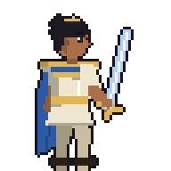

A sellsword from the southern deserts who fights for whoever pays, and right now that's Ithren. Blunt, and keeps her word to the coin.
- **Look:** white linen with a gold and lapis collar, a greatsword resting on her shoulder.
- **Passive: Paid in Full.** +2 Str for the rest of the fight after she defeats an enemy (stacks up to 3 times).
- **Heavy Swing** (arc · CD 2): 1.1× Str.
- **Overhead Cleave** (single, adjacent · CD 3): 1.6× Str, −15 Hit.
- **Second Wind** (self · CD 5): heals 30% of her max HP.

### Kyul: Warlock
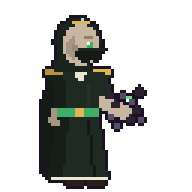

A gravedigger who learned to listen to what the dead still want. Soft-spoken, and the mist follows him.
- **Look:** black and green soul robes, hood and face covering, dark mist round his casting hand.
- **Passive: Soul Harvest.** When an enemy dies within 3 tiles, he restores 4 MP.
- **Soul Bolt** (single, range 4 · 5 MP): 1.2× Mag.
- **Wither** (area r1 at range 3 · 8 MP): 0.8× Mag and Weak.
- **Grasp of the Grave** (single, range 3 · 7 MP): 0.6× Mag and Root.

## Event only

### Lysander: Minstrel

A travelling bard who joined for the songs he'll write about it. Vain, charming, and braver than he looks. Joins through The Wandering Minstrel event.
- **Look:** feathered cap, civilian clothes, lyre.
- **Passive: Audience.** Allies within 2 tiles of him get +10 Hit.
- **Song of Valour** (burst r2 · 6 MP): allies deal 20% more damage for 2 turns.
- **Lullaby** (cone 3 · 8 MP): 50% chance to Stun each enemy hit.
- **Encore** (single ally, range 3 · 15 MP, once per fight): an ally who has already acted acts again this turn.
- **Soothing Ballad** (burst r1 · CD 3): allies around him heal 0.6× Mag.
- **As a Bard:** Song of Valour becomes **Anthem of Valour** (30% more damage and +10 Hit for 2 turns), Lullaby costs 6 MP with a 65% Stun chance, and Soothing Ballad becomes **Soothing Hymn** (CD 2, heals 0.8× Mag and cures statuses).
- He carries no staff and can't heal or attack: he sings.

## Found during the run

Recruited from recruit stops, the caged-traveller event and the tavern, alongside any starting-roster characters you didn't pick. Classes can repeat (more than one archer or rider is fine).

| Name | Class | Ascends into | Gender |
|---|---|---|---|
| Aletta | Mender | Saint or Crusader | F |
| Trent | Cavalier | Paladin or Warlord | M |
| Holt | Crossbowman | Sniper or Artillery | M |
| Sigrun | Drake Rider | – | F |
| Kaya | Horse Archer | – | F |
| Jun | Swordsman | Swordmaster | M |
| Ash | Pyromancer | Pyrolord or Archmage | M |
| Seren | Summoner | Grand Summoner | F |

### Aletta: Mender
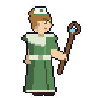

The tavern-keeper's niece, who patches up every brawler in the bar and is tired of doing it for free. Brisk and practical.
- **Ascends into:** Saint or Crusader.
- **Look:** green gown and pale shawl, a small nurse’s cap.
- **Passive: Field Dressing.** Allies she heals also lose one status effect.
- **Mend** (single ally, range 2 · 4 MP): heals 1.0× Mag.
- **Triage** (single ally, adjacent · 6 MP): heals 1.6× Mag, but only on allies below half HP.
- **Smelling Salts** (single ally, adjacent · 5 MP): removes Stun and gives +2 Move this turn.
- **In the game so far:** just **Purify** (single ally, range 3 · 3 MP, 12 MP pool), alongside her mending staff and random skill.

### Trent: Cavalier
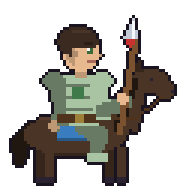

A hot-headed rider from a border garrison that fell to crystallised beasts. Rides first and asks later.
- **Ascends into:** Paladin or Warlord.
- **Look:** green-tinted armour on a dark horse; horse armour and a jousting lance as a Warlord.
- **Passive: Mounted.** +2 Move, but can only climb 1 level at a time.
- **Charge** (line, up to 4 tiles, stops at the first enemy · CD 3): 0.8× Str plus 0.2× for every tile travelled, then push 1.
- **Lance Sweep** (arc · CD 2): 0.9× Str.
- **Run Through** (pierce 2 · CD 3): 1.1× Str to both tiles.

### Holt: Crossbowman
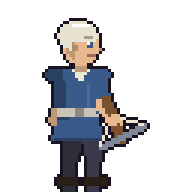

A white-haired militia veteran who has held more walls than he can count. Patient and dry.
- **Ascends into:** Sniper or Artillery.
- **Look:** white hair, blue outfit, crossbow; his crossbow becomes a longbow when he ascends to Sniper.
- **Passive: Braced.** +20 Hit and +2 damage if he didn’t move this turn.
- **Bolt Through** (pierce 2 at range 2 · CD 2): 1.2× Str to both tiles.
- **Crippling Shot** (single, range 2–3 · CD 3): 0.8× Str and Slow.
- **Overwatch** (self · CD 4): until his next turn, he shoots the first enemy that moves into his range.

### Sigrun: Drake Rider
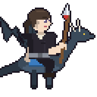

A drake-rider cadet who stole her own mount rather than let it be put down. Fierce, and closer to the drake than to anyone.
- **Look:** dark leathers, crimson scarf and sash, braid, on a green drake.
- **Passive: Wings.** Flies: ignores terrain and height when moving.
- **Dive** (single, within 3 tiles · CD 3): flies to the target and strikes for 1.2× Str.
- **Tail Sweep** (arc · CD 2): 0.8× Str and push 1.
- **Drake Fire** (cone 3 · CD 4): 0.8× Str as fire damage, 30% chance to Burn.

### Kaya: Horse Archer
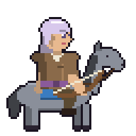

A steppe rider with white-and-violet hair who trades arrows for passage. Laughs a lot, misses rarely.
- **Look:** leathers, shortbow, on a grey horse.
- **Passive: Parthian Shot.** Can move again after attacking, up to her remaining Move.
- **Running Shot** (single, range 2 · CD 2): 1.0× Str, then +2 Move this turn.
- **Twin Arrows** (single, range 2 · CD 3): 2 hits of 0.6× Str.
- **Harry** (single, range 2–3 · CD 3): 0.7× Str and −2 Move on the target.

### Jun: Swordsman
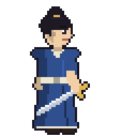

A wandering swordsman from a mountain temple, working off his bar tab. Quiet, and very fast.
- **Ascends into:** Swordmaster.
- **Look:** blue Taoist robes, hair in a bun, sword held low; wristguards and lapels as a Swordmaster.
- **Passive: Flowing Blade.** +15 Avoid on the turn after he attacks.
- **Draw Cut** (single, adjacent · CD 2): 1.3× Str; doubled crit chance if he hasn’t been hit this fight.
- **Crescent** (arc · CD 3): 0.9× Str.
- **Step Through** (2 tiles straight through an enemy · CD 3): passes through and strikes it for 1.0× Str.

### Ash: Pyromancer
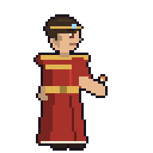

A lamplighter's son who set his first fire by accident and every one since on purpose. Cheerful, a little alarming.
- **Ascends into:** Pyrolord or Archmage.
- **Look:** red robes with gold trim, fire in his hand; orange hem stripes as a Pyrolord.
- **Passive: Kindling.** His fire spells deal +2 damage to Burning enemies.
- **Fire Bolt** (single, range 3 · 4 MP): 1.1× Mag, 30% chance to Burn.
- **Flame Wall** (line 3 · 8 MP): places fire on the tiles for 2 turns: 4 damage to anything entering or starting there.
- **Inferno** (area r1 at range 3 · 12 MP): 1.0× Mag and Burn.

### Seren: Summoner
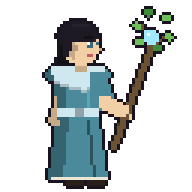

A spirit-speaker who bargained with something old to save her village. Gentle, but what follows her isn't.
- **Look:** long flowing teal robes and shawl, a tall leafy branch staff.
- **Passive: Bond.** Her familiar levels with her and returns at full HP each fight.
- **Summon Familiar** (summon, adjacent · 10 MP): calls her Spirit Frog (the same familiar in every region): wades through water and lashes its tongue from 1–2 tiles.
- **Empower** (familiar · 6 MP): the familiar's next attack deals double damage.
- **Soul Swap** (familiar · 4 MP): she and the familiar swap places.
- **Ascends into Grand Summoner** (from Lv 5): +4 HP, +5 Mag, +2 Spd, +2 Luck, +2 Def, +4 Res; summons twice a fight instead of once and her familiar is 3 levels higher. Darker teal robes with a pale collar and a circlet.
