# Shardbreaker — Visuals

A picture guide to the game as it stands: every region, its monsters and boss, sample characters for each class, weapons, tiles and scenes. All art is drawn in code at 32×32 (bosses 64×64), shown here enlarged.

**Pitch:** malignant crystals are spreading through the land's creatures, and the scent of the crystallised beasts is driving the kingdoms to war. Ithren the Sage sends a small band to break the crystals at their heart. A run is 2 acts in 2 of 10 regions; you recruit, promote and lose units along the way. Every enemy is a creature, and every creature is crystallised; each boss has its own crystal colour.

## Contents
- [Opening scenes](#opening-scenes)
- [Regions and bosses](#regions-and-bosses)
- [Familiars](#familiars)
- [Battle sprites](#battle-sprites)
- [Characters](#characters)
- [Weapons](#weapons)
- [Region tiles](#region-tiles)
- [Event scenes](#event-scenes)

## Opening scenes

| Ithren's tent | The Crossroads |
| --- | --- |
| 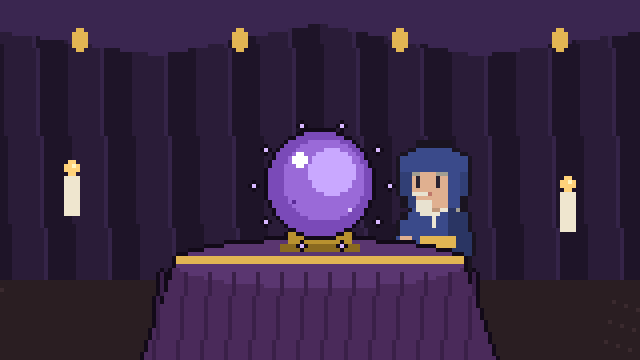 | 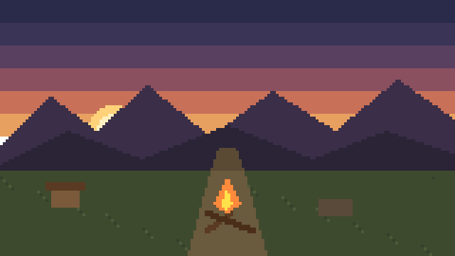 |

Ithren explains the blight over his crystal ball (difficulty arrows appear above it once Ascension is unlocked), then the squad is picked at the Crossroads: 3 of 5 travellers, always one Mender.

## Regions and bosses

Bosses fill 2×2 squares on the map. The Roc, Bone Wyrm, Krondis and Hollow Bear are drawn at full 64×64; the others are their 32px art doubled for now.

### Mycelia

Glowing mycelium and giant toadstools. The fungus folk have turned feverish under the blight, and their spores poison on a hit. **Rule:** Fungus attacks poison on a hit: 3 damage at the start of each of your turns for 3 turns. A Salve cures it.

| Boss: King Morel the Blighted | Attacking |
| --- | --- |
|  |  |

| Sporeling | Mindsnail |
| --- | --- |
|  | 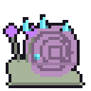 |

### Sunless Isle

A haunted land of graves and crypts. Skeletons walk, and ghosts drift straight through walls. **Rule:** Ghosts ignore terrain and can pass through walls. Their dark magic heals them for a third of the damage dealt.

| Boss: The Bone Wyrm | Attacking |
| --- | --- |
| 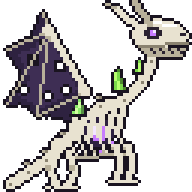 | 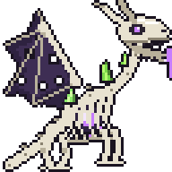 |

| Skeleton | Ghost |
| --- | --- |
| 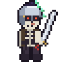 |  |

### Bog of Eternal Stench

Mangrove roots and ankle-deep water. Lurkers and lamias hunt the shallows; the sand banks are solid ground. **Rule:** A unit that starts its turn in the water or the mangrove roots has 1 less Move. Sand is solid ground. Fliers and swamp creatures ignore this.

| Boss: Krondis | Attacking |
| --- | --- |
| 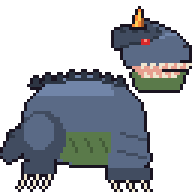 | 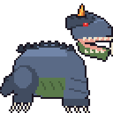 |

| Bog Lurker | Lamia | Mud Monster |
| --- | --- | --- |
| 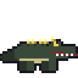 | 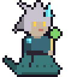 | 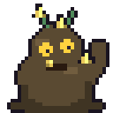 |

### Cursed Woodland

A dead forest under a curse. The deer here have gone wrong, wolves hunt in packs, and the trees themselves are waking up. **Rule:** Cursed thickets give +25 Avoid and +1 Def, but cost 2 Move to enter. Stags are fast: keep your back line covered.

| Boss: The Hollow Bear | Attacking |
| --- | --- |
| 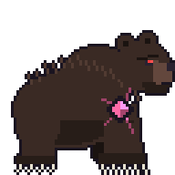 | 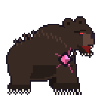 |

| Wolf | Cursed Stag | Blighted Treant |
| --- | --- | --- |
| 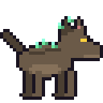 | 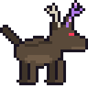 | 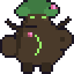 |

### Volcanic Isle

Basalt slopes cut by rivers of magma. Golems block the passes, and fire sprites float over the lava. **Rule:** Magma can’t be crossed on foot. Fliers and fire creatures move over it freely.

| Boss: Pyraxis, the Magma Dragon | Attacking |
| --- | --- |
| 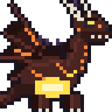 | 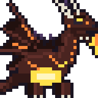 |

| Fire Sprite | Boulder Golem | Harpy |
| --- | --- | --- |
|  | 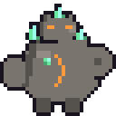 |  |

### The Flying Ship

A sky-galleon under attack. Hold the deck while wyverns, pegasi and harpies dive from the clouds. **Rule:** Hold the deck until the turn count runs out; more fliers arrive every turn. Bows deal double damage to fliers.

| Boss: The Great Roc | Attacking |
| --- | --- |
| 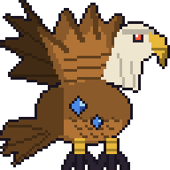 | 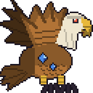 |

| Harpy | Wyvern |
| --- | --- |
|  | 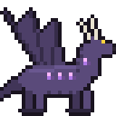 |

### The Labyrinth

Stone corridors with no daylight. Something with too many eyes watches from the dark. **Rule:** Beholders can turn units to stone with their gaze. Stone units skip their next turn.

| Boss: Minotaur lord | Attacking |
| --- | --- |
| 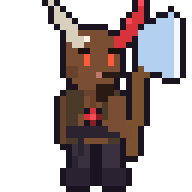 | 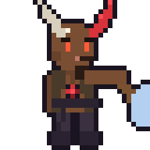 |

| Gremlin | Beholder |
| --- | --- |
| 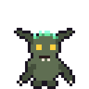 |  |

### The Heart of the Blight

Scorched ground split by veins of glowing gem. Every crystal in these lands grew from what waits here. **Rule:** The Heart never moves, but it strikes from 2 to 6 tiles away. Get next to it: it can’t hit what’s beside it. It calls more blighted monsters every other turn.

| Boss: The Crystal Heart | Attacking |
| --- | --- |
| 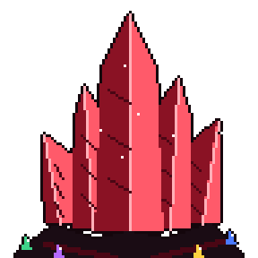 | 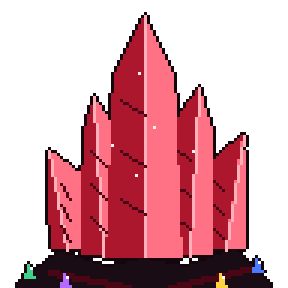 |

| Shardling | Prism | Crystal Sentinel |
| --- | --- | --- |
| 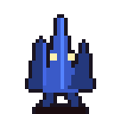 |  | 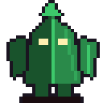 |

### Sandstone Desert

Dunes and sandstone ruins under a white sun. Jackals run in packs, and the quicksand swallows the careless. **Rule:** A unit that starts its turn in quicksand has 1 less Move. Sandstone rocks block the way.

| Boss: The Pyrite Colossus | Attacking |
| --- | --- |
| 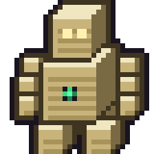 | 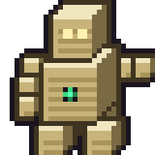 |

| Jackal | Sand Worm | Sandstone Golem |
| --- | --- | --- |
| 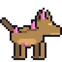 | 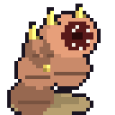 | 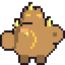 |

### Agate Peaks

Snowfields studded with blue agate. Frost wolves hunt the drifts, and the golems are made of the agate itself. **Rule:** A unit that starts its turn in deep snow has 1 less Move (snow creatures ignore it). Frozen lakes give −10 Avoid; blue agate gives +20 Avoid and +2 Def.

| Boss: Glacius, the Agate Wyrm | Attacking |
| --- | --- |
| 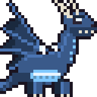 | 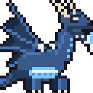 |

| Frost Wolf | Frost Sprite | Agate Golem |
| --- | --- | --- |
| 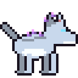 |  |  |

### Gemstone Caverns

Caves glittering with emerald, ruby and sapphire, and chests everywhere. Not everything that shines is gold. **Rule:** Open chests for gold, but some hold only pyrite. Gem clusters give +20 Avoid and +2 Def.

| Boss: Amethyra, the Amethyst Turtle | Attacking |
| --- | --- |
| 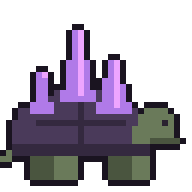 | 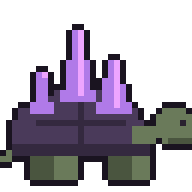 |

| Gremlin | Gemsnail | Gem Golem |
| --- | --- | --- |
|  | 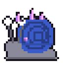 |  |

## Familiars

Each Summoner is bonded to one familiar for life and calls it once per battle (twice once promoted). Familiars are spirits, not region creatures: pale blue, translucent and crystal-free.

| Spirit Wolf: fast, bites in melee | Stone Warden: slow and sturdy, a wall for the back line | Wisp: floats, casts light magic at range 1–2 | Spirit Hawk: flies, quick strikes |
| --- | --- | --- | --- |
| 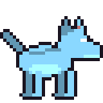 |  |  | 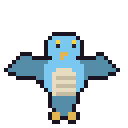 |

## Battle sprites

Every generated unit is drawn from body parts (`js/09b-battle-rig.js`). The same drawing is the 64px map sprite and the 96px battle frames. Each weapon kind uses one pose set; each set has the same eight frames: two idle breaths, wind-up, crit wind-up, swing (the hit frame), follow-through, hit flinch and dodge. Mounts move with the rider (horses rear on the wind-up and gallop on the strike).

### Heavy: axes, halberds, hammers, greatswords

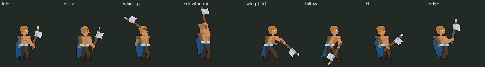

### Blade: swords, scimitars, twin blades

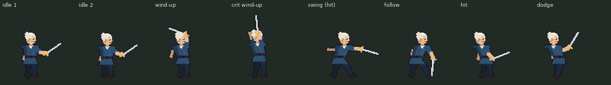

### Thrust: spears, javelins, rapiers

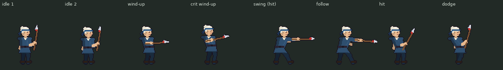

### Dagger: daggers, whips, chains

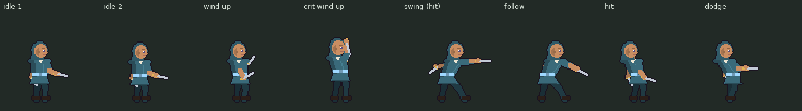

### Bow: bows and crossbows

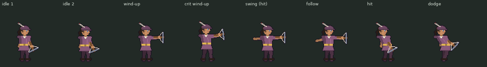

### Cast: sigils

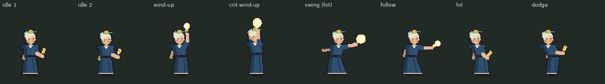

### Cast: staves

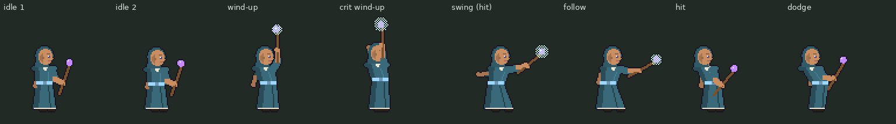

### Cast: charms

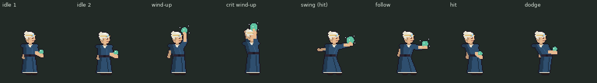

### Armoured (Knight)

### Mounted (horse)

### Flying (pegasus)

### Flying (wyvern)

## Characters

Looks are random (hair, skin, cloth, headgear, cape, beard; mounts get random coats with team barding). A few rolls per class, with the promoted form after the first of each movement type. Rogues, Summoners and Knights only have one movement type.

### Fighter

| Fighter | Warrior (promoted) | Fighter | Rider | Warlord (promoted) |
| --- | --- | --- | --- | --- |
|  |  |  |  |  |

| Rider | Wyvern Rider | Wyvern Lord (promoted) | Wyvern Rider |
| --- | --- | --- | --- |
|  |  |  |  |

### Guard

| Axe Guard | Axe Bastion (promoted) | Axe Guard | Lance Cavalier | Lance Paladin (promoted) |
| --- | --- | --- | --- | --- |
|  |  |  |  |  |

| Axe Cavalier | Lance Wyvern Knight | Lance Dragonmaster (promoted) | Axe Wyvern Knight |
| --- | --- | --- | --- |
|  |  |  |  |

### Skirmisher

| Lance Skirmisher | Lance Duelist (promoted) | Blade Skirmisher | Lance Outrider | Lance Ranger (promoted) |
| --- | --- | --- | --- | --- |
|  |  |  |  |  |

| Lance Outrider | Blade Pegasus Knight | Blade Falcon Knight (promoted) | Blade Pegasus Knight |
| --- | --- | --- | --- |
|  |  |  |  |

### Sigilist

| Sigilist | Runelord (promoted) | Sigilist | Battlemage | Archmage (promoted) |
| --- | --- | --- | --- | --- |
|  |  |  |  |  |

| Battlemage | Sky Mage | Storm Sage (promoted) | Sky Mage |
| --- | --- | --- | --- |
|  |  |  |  |

### Mender

| Mender | Lightbearer (promoted) | Mender | Troubadour | Valkyrie (promoted) |
| --- | --- | --- | --- | --- |
|  |  |  |  |  |

| Troubadour | Sky Mender | Seraph (promoted) | Sky Mender |
| --- | --- | --- | --- |
|  |  |  |  |

### Rogue

| Rogue | Assassin (promoted) | Rogue |
| --- | --- | --- |
|  |  |  |

### Swordsman

| Swordsman | Swordmaster (promoted) | Swordsman | Blade Rider | Blade Lord (promoted) |
| --- | --- | --- | --- | --- |
|  |  |  |  |  |

| Blade Rider | Sky Blade | Sky Master (promoted) | Sky Blade |
| --- | --- | --- | --- |
|  |  |  |  |

### Shieldmaiden

| Shieldmaiden | Shield Warden (promoted) | Shieldmaiden | Shield Rider | Shield Lord (promoted) |
| --- | --- | --- | --- | --- |
|  |  |  |  |  |

| Shield Rider | Sky Shield | Valkyrie Knight (promoted) | Sky Shield |
| --- | --- | --- | --- |
|  |  |  |  |

### Knight

| Knight | General (promoted) | Knight |
| --- | --- | --- |
|  |  |  |

### Summoner

| Summoner | Conjurer (promoted) | Summoner |
| --- | --- | --- |
|  |  |  |

## Weapons

| Jade Jian | Jade Fang | Jade Spear | Jade Axe | Jade Bow | Spark Sigil |
| --- | --- | --- | --- | --- | --- |
|  |  |  |  |  |  |

| Thunderhead Sigil | Meteor Sigil | Heaven’s Bolt | Longbow | Throwing Knives | Crook Staff |
| --- | --- | --- | --- | --- | --- |
|  |  |  |  |  |  |

| Rune Staff | Far Charm | Dirk | Twin Daggers | Stiletto | Crossbow |
| --- | --- | --- | --- | --- | --- |
|  |  |  |  |  |  |

| Knightly Sword | Hatchet | Iron Spear | Short Bow | Ember Sigil | Umbral Sigil |
| --- | --- | --- | --- | --- | --- |
|  |  |  |  |  |  |

Jade weapons are the high-crit (killer) line; Meteor Sigil and Heaven's Bolt reach 3–10 tiles in Act 2; staves belong to Summoners; daggers to Rogues.

## Region tiles

| Sandstone Rocks | Quicksand | Snow | Deep Snow | Blue Agate | Frozen Lake |
| --- | --- | --- | --- | --- | --- |
|  |  |  |  |  |  |

| Cave Floor | Iridescent Rock | Emerald Cluster | Ruby Cluster | Sapphire Cluster |
| --- | --- | --- | --- | --- |
|  |  |  |  |  |

The iridescent cave walls and feldspar-with-smoky-quartz sandstone are based on museum mineral photos.

## Event scenes

| smith | armoury | enchanter |
| --- | --- | --- |
|  |  |  |

| shrine | spar | merchant |
| --- | --- | --- |
|  |  |  |

| gamble | idol | cage |
| --- | --- | --- |
|  |  |  |

| spring | well | battlefield |
| --- | --- | --- |
|  |  |  |

| jadetomb | stormaltar | cache |
| --- | --- | --- |
|  |  |  |

| veteran | statue | drill |
| --- | --- | --- |
|  |  |  |

| toll | witch | fog |
| --- | --- | --- |
|  |  |  |

| chest | library | star |
| --- | --- | --- |
|  |  |  |

| spire | oracle | sage |
| --- | --- | --- |
|  |  |  |

| hoard | echo | fallen |
| --- | --- | --- |
|  |  |  |

| seam |
| --- |
|  |

Each event scene is tinted to the region it appears in (shown here in the first region).

---
Images are exported from the game with a headless browser (`fig()`, `icon()`, `bioTile2()`, `eventScene()` and the scene functions), scaled up with nearest-neighbour. The full design decisions live in the Shardbreaker spec doc (Decisions tab).

## High-res units

Every generated unit is built from body parts (js/09b-battle-rig.js). Map sprites are 64px and battle frames are 96px.

Battle poses for every weapon set and mount are under **Battle sprites** above.

## Title screen

A blighted red crystal in the distance, with corruption veins pulsing through the land and red shards drifting upward.

## Effective damage

Monsters carry body tags, shown on their info sheet and in the forecast: wing (Flier), shell (Armoured), paw (Beast), crown (Colossal), ghost (Spectral), leaf (Plant). Slayer weapons and skills deal ×2 weapon might to their tag, and so do bows against fliers.

A possible variant with three crystals and more veins (`TITLE_MULTI=true` in js/28-startup.js):

## The Flying Ship

The ship isn't a tile set: it's drawn on the fly from the map letters (d deck, h hull, M mast, H helm) by `shipArt()` in `js/04-ship-art.js`, with sails either side. Two layouts:

| Main Deck | Galleon Deck |
|---|---|
|  |  |

## Battle backdrops

The side-on fight scene uses a backdrop for the current region (`battleBgArt` in js/09-battle-scene.js, 160×90, horizon at y 63). Regions without one fall back to the old terrain gradients. `heart` is Act 3.

